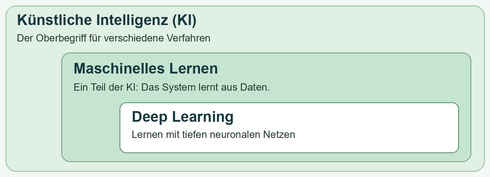
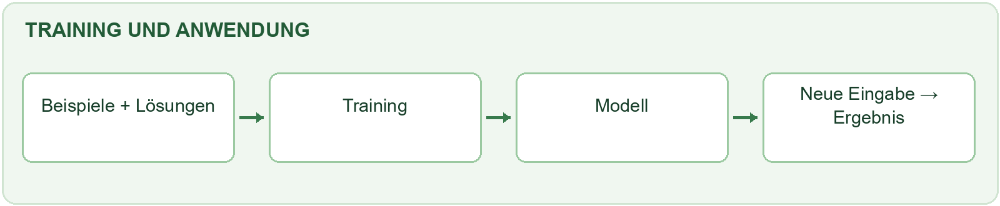
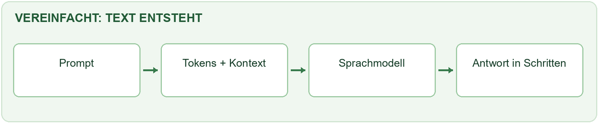

# Was ist künstliche Intelligenz?

**Künstliche Intelligenz (KI)** ist ein Sammelbegriff für Computerverfahren, die Aufgaben wie Erkennen, Sprache oder Planen bearbeiten. Manche folgen festen Regeln, andere lernen Muster aus Daten.

KI denkt nicht automatisch wie ein Mensch. Sie verarbeitet Daten und kann sich dabei auch irren.

Beispiel:

> Ein Taschenrechner rechnet 7 × 8 nach einer festen Regel. Ein lernender Spamfilter untersucht viele E-Mails und schätzt bei einer neuen Nachricht, ob sie Spam ist. Auch diese Einschätzung kann falsch sein.

# Wie hängen die Begriffe zusammen?

KI ist der Oberbegriff. **Maschinelles Lernen** ist ein Teil davon: Ein Modell wird mit Daten angepasst. **Deep Learning** ist eine Form davon und nutzt tiefe neuronale Netze.

{width="100%"}

Nicht jede KI lernt aus Daten. Und nicht jedes maschinelle Lernen verwendet Deep Learning.

# Wie lernt ein Modell?

Ein **Modell** ist ein Computerprogramm, dessen Einstellungen beim Lernen angepasst werden. Die Beispiele dafür bilden den **Datensatz**. Eine Eigenschaft eines Beispiels heißt **Merkmal**.

Beispiel:

> Beim Spamfilter können Wörter in einer E-Mail Merkmale sein. Die Angabe „Spam“ oder „erwünscht“ zeigt bei einem Trainingsbeispiel die gewünschte Einordnung. Diese Angabe heißt auch Label.

Beim hier gezeigten **überwachten Training** vergleicht das Lernverfahren seine Ergebnisse mit bekannten Lösungen und passt das Modell an.

{width="100%"}

Danach bearbeitet das trainierte Modell neue Eingaben. Diese **Anwendung** nennt man auch Inferenz. Bei einer einzelnen Anfrage wird das Modell normalerweise nicht neu trainiert.

# Drei Arten des Lernens

Computer können auf verschiedene Arten aus Daten oder Rückmeldungen lernen:

| Lernart | Einfach erklärt | Beispiel |
|---|---|---|
| Überwachtes Lernen | Beispiele enthalten bekannte Lösungen. | E-Mails sind als Spam oder erwünscht markiert. |
| Unüberwachtes Lernen | Das Verfahren sucht ohne vorgegebene Lösungen nach Gruppen oder Mustern. | Musikstücke werden nach Tempo und Klang gruppiert. |
| Bestärkendes Lernen | Ein System erhält für Entscheidungen positive oder negative Rückmeldungen. | Ein Spielprogramm erhält eine Belohnung, wenn es ein Ziel erreicht. |

# Was ist ein neuronales Netz?

Ein **künstliches neuronales Netz** besteht aus vielen verbundenen Recheneinheiten. Sie verarbeiten Daten in mehreren Schritten. Beim Training werden Zahlen in den Verbindungen angepasst. Diese Zahlen nennt man **Gewichte**.

Beispiel:

> Ein Netz kann ein Bild verarbeiten und einschätzen, ob darauf eher eine Katze oder ein Hund zu sehen ist. Die Einschätzung muss nicht stimmen.

Deep Learning verwendet Netze mit mehreren inneren Schichten. Die Recheneinheiten sind keine echten Nervenzellen und das Netz ist kein menschliches Gehirn.

# Warum kann KI Fehler machen?

Ein Modell erkennt Muster in seinen Trainingsdaten. Diese Muster passen aber nicht immer zu neuen Situationen.

Beispiel:

> Wenn auf fast allen Trainingsbildern Katzen auf Sofas und Hunde im Garten zu sehen sind, könnte das Modell den Hintergrund statt des Tieres beachten. Eine Katze im Garten könnte es falsch einordnen.

Damit ein Modell nicht nur bekannte Beispiele gut löst, testet man es mit anderen, zuvor nicht zum Training verwendeten Daten. Gute Ergebnisse bei einem Test garantieren trotzdem nicht, dass es immer richtig liegt.

Passt sich ein Modell zu stark an die Trainingsbeispiele an, heißt das **Überanpassung**. Wenn es auch passende neue Beispiele gut bearbeitet, spricht man von **Verallgemeinerung**.

# Wie erzeugt ein Sprachmodell Text?

**Generative KI** erzeugt neue Inhalte, zum Beispiel Texte, Bilder oder Ton. Ein **Sprachmodell** ist auf Sprache spezialisiert. Ein **Chatbot** ist eine Anwendung, über die Menschen mit einem solchen Modell schreiben können.

Eine Eingabe an eine KI nennt man **Prompt**. Das Modell verarbeitet den Text in kleinen Bausteinen, den **Tokens**. Ein Token kann zum Beispiel ein Wort, ein Wortteil oder ein Satzzeichen sein. Aus dem bisherigen Textzusammenhang entsteht eine Antwort Schritt für Schritt.

{width="100%"}

Beispiel:

> Nach „Die Katze sitzt auf dem …“ können zum Beispiel „Sofa“ oder „Boden“ passen. Der bisherige Text beeinflusst, welche Fortsetzung gewählt wird.

Viele Sprachmodelle verwenden einen Aufbau namens **Transformer**. Ein Teil davon heißt **Attention**: Er berücksichtigt, welche Teile des bisherigen Textes für die Verarbeitung wichtig sein können. Das bedeutet nicht, dass die KI bewusst aufmerksam ist.

Eine Antwort kann überzeugend klingen und trotzdem falsch sein. Wenn ein Modell Angaben oder Quellen erfindet, nennt man das eine **Halluzination**. Wichtige Aussagen sollten deshalb anhand verlässlicher Quellen geprüft werden.

# Fachbegriffe auf einen Blick

| Begriff | Bedeutung |
|---|---|
| Algorithmus | Eine Folge von Schritten, die ein Computer ausführt. |
| Datensatz | Eine Sammlung von Beispielen oder anderen Daten. |
| Merkmal | Eine Eigenschaft, die für die Verarbeitung verwendet wird. |
| Label | Eine vorgegebene Lösung oder Einordnung zu einem Beispiel. |
| Modell | Eine Rechenstruktur, deren Einstellungen beim Lernen angepasst werden können. |
| Parameter und Gewichte | Zahlen im Modell, die beim Training angepasst werden. |
| Training | Das Anpassen eines Modells mithilfe von Daten. |
| Inferenz | Die Anwendung eines trainierten Modells auf neue Eingaben. |
| Klassifikation | Die Zuordnung zu einer Kategorie, zum Beispiel Spam. |
| Regression | Die Schätzung einer Zahl, zum Beispiel einer Fahrzeit. |
| Überanpassung | Das Modell passt zu gut zu Trainingsbeispielen und oft schlechter zu neuen Daten. |
| Verallgemeinerung | Ein Modell bearbeitet auch passende neue Beispiele gut. |
| Neuronales Netz | Ein Modell aus verbundenen Recheneinheiten. |
| Deep Learning | Lernen mit neuronalen Netzen mit mehreren inneren Schichten. |
| Prompt | Eine Eingabe oder Frage an ein KI-System. |
| Kontext | Der bisherige Zusammenhang, den das Modell bei einer Anfrage berücksichtigt. |
| Token | Ein Textbaustein, den ein Sprachmodell verarbeitet. |
| Transformer und Attention | Ein Modellaufbau und eine Berechnung, die den Zusammenhang im Text berücksichtigen. |
| LLM | Ein großes Sprachmodell; die Abkürzung steht für Large Language Model. |
| Halluzination | Eine erfundene oder falsche Ausgabe einer KI, die plausibel wirken kann. |

# Weiterführende Informationen

Diese Seiten erklären maschinelles Lernen und neuronale Netze ausführlicher.

::: {.web-link title="Google: Einführung in maschinelles Lernen" url="https://developers.google.com/machine-learning/intro-to-ml/what-is-ml"}
:::

::: {.web-link title="Google: Neuronale Netze" url="https://developers.google.com/machine-learning/crash-course/neural-networks"}
:::
